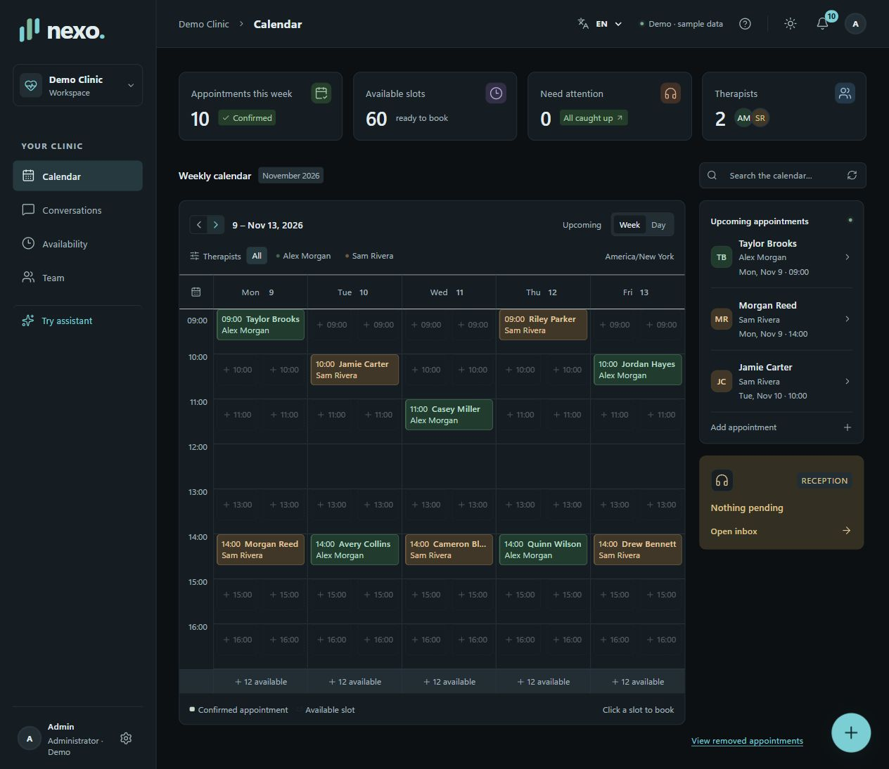

  
  <h1>Nexo — Clinic Booking Assistant</h1>
  
A shared workspace for physical therapy clinics. Natural-language booking, coordinated schedules and connected calendars.

  

    <a href="https://www.tella.tv/video/vid_cmw5how9u000008jmct6rcsgl/view"><strong>Watch the demo ↗</strong></a>
    &nbsp;·&nbsp; English & Spanish interface
  

  

    
    
    
    
  

English dashboard · Sample data · The video walkthrough is in Spanish.

## Features

- **Book through Telegram.** Patients request appointments in natural language, choose a therapist or time window, and confirm using guided buttons. The assistant can book a full week, reschedule or cancel appointments.
- **Manage a shared calendar.** Weekly and daily views, flexible patient and therapist search, manual bookings, rescheduling, cancellations and recovery of removed appointments.
- **Keep patient details together.** Shared records with required name and phone, plus optional insurance, patient-reported diagnosis and additional notes.
- **Bring a person into the conversation.** A reception inbox with persistent chat history, human handoff, staff replies and the option to resume the assistant.
- **Give therapists their own workspace.** Role-based access for administrators, reception and therapists; professional profiles, working hours, breaks, session duration and time off.
- **Connect Google Calendar and Gmail.** Each therapist connects their own account. Nexo syncs appointments, changes and cancellations, sets a 30-minute reminder and emails new booking notifications.
- **Stay informed.** Appointment activity feed, browser notifications, sound preferences and quick actions.
- **Choose your interface.** English or Spanish, light or Obsidian dark mode, responsive layouts and reduced-motion support.

## Tech stack

| Layer | Technologies |
| :--- | :--- |
| Frontend | React, TypeScript, Vite, Lucide |
| Backend | Node.js, Fastify, Zod |
| Data & authentication | Supabase Auth, PostgreSQL, SQL migrations; optional local PGlite storage |
| AI | OpenRouter, GPT-6 Luna; backend-controlled availability and booking |
| Messaging | Telegram Bot API, long polling, persistent delivery queue |
| Integrations | Google Calendar API, Gmail API, OAuth 2.0 |
| Dates & time zones | Temporal |
| Quality | Vitest, TypeScript checks, GitHub Actions |
